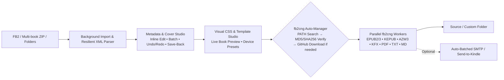

<div align="center">

# 📚 FBC GUI

**Cross-platform desktop studio for converting, styling, and delivering FB2 e-books with [`fb2cng`](https://github.com/rupor-github/fb2cng)**

<p>
  <a href="https://pashka.eu/fbc_gui/"></a>
  <a href="https://github.com/PDykun/fbc-gui/releases"></a>
  <a href="https://github.com/PDykun/fbc-gui/actions/workflows/tests.yml"></a>
  <a href="LICENSE"></a>
</p>

<p>
  <a href="https://github.com/PDykun/fbc-gui/releases"></a>
  <a href="https://github.com/PDykun/fbc-gui/releases"></a>
  <a href="#running-from-source"></a>
  <a href="#detailed-reference"></a>
</p>

[Official Website](https://pashka.eu/fbc_gui/) •
[Download Installers](https://github.com/PDykun/fbc-gui/releases) •
[User Guide (EN)](docs/USER_GUIDE_EN.md) •
[Руководство (RU)](docs/USER_GUIDE_RU.md) •
[Release Notes](docs/README.md) •
[Why FBC GUI?](#why-fbc-gui) •
[Key Features](#key-features) •
[How It Works](#how-it-works) •
[Running from Source](#running-from-source) •
[License](#license--third-party-notices)

</div>

---

**FBC GUI** is a fast, native desktop studio (**macOS Apple Silicon & Intel**, **Windows x64 & ARM64**) built around the next-generation [`fb2cng`](https://github.com/rupor-github/fb2cng) converter. Instead of juggling raw YAML configs, hand-edited CSS, command-line flags, or heavy library managers, FBC GUI gives you a **visual typography editor with two-page book-spread preview**, **batch metadata & cover editing with full Undo/Redo**, **drag-and-drop filename & title template builders**, **one-click e-reader presets**, **direct Send-to-Kindle / SMTP delivery**, and **SHA-256 verified in-app updates** — all in a single clean interface.

> [!TIP]
> **Official project website, screenshots & full visual guide (EN / RU):** **[https://pashka.eu/fbc_gui/](https://pashka.eu/fbc_gui/)**

---

## Why FBC GUI?

Most FB2 conversion workflows force a trade-off: **Calibre** is heavy and uses a generic HTML pipeline that often loses FB2 typography nuances; **raw `fb2cng` CLI** produces great books but requires manual YAML/CSS/Go-template editing; **online converters** limit file sizes, upload your library to third-party servers, and offer almost no styling control.

| Capability | **FBC GUI** | Raw `fb2cng` CLI | Calibre | Online Converters |
| :--- | :---: | :---: | :---: | :---: |
| **Native `fb2cng` engine** (EPUB2/3, KEPUB, AZW3, KFX/AZW8, PDF, TXT, MD) | ✅ All 10 formats | ✅ CLI flags | ⚠️ Generic pipeline | ❌ Limited formats |
| **Zero-config engine setup** (auto-detect, MD5/SHA256 verify & GitHub download) | ✅ Automatic | ❌ Manual | ❌ N/A | ➖ Cloud |
| **Visual CSS & typography studio** (fonts, drop caps, footnotes, headings, SVG) | ✅ Live controls | ❌ Manual CSS | ⚠️ Raw CSS box | ❌ None |
| **Live preview on your actual FB2 book** (2-page spread, WebKit / WebView2 + E-Ink B&W) | ✅ 2-page spread & sample | ❌ None | ⚠️ After convert | ❌ None |
| **Visual drag-and-drop Go-template builder** (`output_name` & `title_template`) | ✅ Pill timeline | ❌ Hand-written Go | ⚠️ Python templates | ❌ None |
| **Batch metadata, series auto-numbering & cover auto-fit (`600×900`)** | ✅ Inline + Undo/Redo | ❌ External tools | ✅ Library-bound | ❌ None |
| **Write edited metadata & covers back into source `.fb2` / `.zip`** | ✅ Atomic save-back | ❌ Read-only | ⚠️ Copies to DB | ❌ None |
| **Device profiles + exportable Settings+CSS presets** (`.fbcpreset.json`) | ✅ 8 built-in + custom | ❌ Manual YAML | ⚠️ Separate profiles | ❌ None |
| **Direct Send-to-Kindle / SMTP** with Keychain / Windows Credential Manager | ✅ Auto-batched (20 MB) | ❌ External tool | ✅ Built-in | ❌ Manual |
| **100% local & private** (no library lock-in, no cloud uploads) | ✅ Local files | ✅ Local files | ⚠️ Own DB copy | ❌ Cloud upload |

---

## Key Features

### ⚡ Next-Gen Conversion Engine & Formats
- **10 output formats without Calibre or KindleGen:** `EPUB2`, `EPUB3`, `KEPUB`, `KEPUB3`, native `AZW3` (with optional `.apnx` page sidecars & HuffDic/Standard compression), `KFX` / `AZW8` (LZMA compression), `PDF`, `TXT`, and `Markdown`.
- **Parallel multi-threaded batch conversion:** configurable worker pool (`Auto` or `1–8` concurrent `fb2cng` processes) with per-book live status (`⏳ Running`, `✓ Done`, `✕ Error`, `⊘ Cancelled`).
- **Instant cancellation & Retry Failed:** cancelling terminates active `fbc` subprocesses immediately; failed books can be retried in one click from the summary dialog.
- **One-click `--debug` diagnostic reports:** generate `*_fbc-report.zip` archives directly from the table context menu for troubleshooting malformed books.
- **Resilient broken-FB2 parser:** handles missing `xmlns:l`, unescaped `&`, UTF-8 BOM, control characters, legacy `windows-1251` / `KOI8-R` encodings, and multi-book `.zip` archives without crashing.

### 🗂️ Batch Queue & Metadata Studio
- **Non-blocking background import:** drag-and-drop folders, `.fb2`, or multi-book `.zip` archives with lazy on-demand XML loading to keep RAM usage low on large libraries.
- **Inline table editing & extended metadata studio:** edit Author (Last / First / Middle), Series, Series #, and Book Title directly in the table, or open the two-tab **Edit Book** / **Batch Edit** dialogs to manage **FB2 Genres** (searchable FictionBook 2.1 taxonomy + custom tags + Add/Replace/Remove batch modes), **Language**, **Translator** (preserving co-translators), **Publisher**, **ISBN** (with ISBN-10/13 validation), and **Annotation** (with rich-XML preservation when untouched).
- **Online Cover & Metadata Lookup (`FantLab`, `LitRes`, `Open Library`, optional `Google Books` & custom `OPDS`):** fetch missing covers, series, genres, annotations, translators, publishers, and ISBNs directly from the cover panel (**Fetch Online**), context menu, or **Edit Book** dialog. Supports any standard **OPDS (Atom XML / OpenSearch)** catalog (Calibre-Web, Kavita, self-hosted archives, or public OPDS libraries) with optional Basic Auth, a **Current → Found** comparison table (**Empty Only / All Found / Cover Only**), a deduplicated cover gallery, and full Undo/Redo.
- **Series auto-numbering & row ordering:** automatically number selected books (`1, 2, 3…`), sort by any column, or reorder rows via `Alt+↑` / `Alt+↓`.
- **Full Undo / Redo (`QUndoStack`):** undo/redo every metadata edit, online lookup, batch update, cover replacement, row reorder, removal, or list clear (`Cmd/Ctrl+Z`, `Shift+Cmd+Z` / `Ctrl+Y`).
- **Pre-flight diagnostics, FB2 Structure Inspector & Auto-Repair:** lightweight import checks flag XML defects, missing covers, or empty metadata with a `⚠` badge and **⚠ Warnings** filter pill; open **FB2 Inspector...** from the context menu to inspect XML status, chapter TOC tree, footnote counts, and embedded images (`> 2 MB` / corrupted detection), run **Repair & Optimize FB2** (clean UTF-8 XML, strip broken binaries, downsize oversized images), or launch diagnostic report conversion in one click.
- **Source FB2 Organizer (without conversion):** copy or move selected `.fb2` / `.fb2.zip` files into **Author / Series / File**, **Author / File**, or **Flat** folder layouts with a live **Before → After** preview table.
- **Queue deduplication & skip existing:** automatically flags logical duplicates (by author, series, number, and title) with a one-click **Remove duplicates** action (Undo/Redo supported), and lets you toggle **Skip existing** to bypass already up-to-date output files (`↷ Skipped`).
- **Real-time search & status filters:** instant filter (`Cmd/Ctrl+F`, `Esc` to reset) across filenames, authors, series, titles, genres, language, publisher, ISBN, and output names, paired with status pills (**All / Pending / Done / Errors / ⚠ Warnings**).
- **Cover manager & save-back to source:** preview covers, replace with automatic `600×900 px` LANCZOS aspect-fit resizing, restore originals, and atomically write edited metadata & covers back into the original `.fb2` or `.zip` file.

### 🎨 Visual CSS & Live Book Preview
- **Complete visual stylesheet builder (`ebook_styles.css`):** configure body/title/author/drop-cap fonts (or `None` to use e-reader system fonts), heading hierarchy (`H1–H5`), paragraph alignment & indents, drop caps, annotations, epigraphs, poems, footnotes (background & border), illustration widths, and PDF page frames.
- **Built-in User Font Manager:** install custom `.ttf`, `.otf`, `.woff`, and `.woff2` fonts via the **+ Add Font...** button or direct Drag & Drop with magic-byte validation and instant picker/preview refresh.
- **Two-page book-spread live preview:** renders your currently selected FB2 book as a realistic spread — full-bleed cover with spine shadow on the left page and title, annotation, epigraph, and opening chapter on the right — or a comprehensive style sample inside a native web view (**WKWebView** on macOS, **Edge WebView2** on Windows) or your system browser.
- **E-Ink Grayscale preview:** toggle `Grayscale (Luma)` to inspect how illustrations and typography will look on monochrome e-ink screens.
- **Automatic font embedding & weight isolation:** selected fonts from `fonts/` (including bundled open-source **PT Astra Serif** and **Pomorsky Unicode**) are automatically resolved with properly isolated Regular / Bold / Italic `@font-face` rules and embedded during conversion.

### 📱 Device Presets, Typography & Template Builders
- **8 built-in e-reader presets + custom shareable bundles (`.fbcpreset.json`):** switch entire conversion + CSS configurations in one click, restore defaults, or export/import presets with friends (private SMTP credentials and local paths are automatically stripped).
- **Visual drag-and-drop template builders:** build Go templates visually using draggable metadata pills (`Last Name`, `First Name`, `Series`, `Series Abbr`, `Series #`, `Title`, `Format`) and custom separators for both:
  - **Output filenames** (`output_name_template`) with live preview (with & without series);
  - **E-reader library titles** (`metainformation.title_template`).
- **Full `fb2cng` typography, navigation & image controls:** soft hyphenation, drop caps toggle, direct speech / dash / dialogue `text_transformations`, separate annotation page & annotation-in-TOC, visible TOC placement (`None / Before / After`), TOC type (`Normal / Old Kindle / Flat`), untitled chapters in TOC, EPUB `page_map` (with Adobe DE mode), `fix_zip`, image `scale_factor` (`0.5–2.0`), open-from-cover, auto-generated fallback covers, `--no-cover`, Baseline JPEG compatibility, SVG vector vs. raster toggle, transparency removal, grayscale, screen resolution & DPI.

### ✉️ Direct Device Delivery (USB / MTP) & Send-to-Kindle (SMTP)
- **USB / MTP & Mounted Folder Sync (`sync2kindle`):** deliver converted books straight to modern MTP Kindles (Scribe, PW12, Colorsoft), legacy USB Kindles via `sync2kindle` (`s2k`, auto-downloaded from GitHub with checksum verification), or mounted Kobo / PocketBook folders with **Dry Run** preview and local-file protection.
- **Automatic SMTP delivery:** optionally email converted books straight to your Kindle / PocketBook / personal inbox right after conversion finishes, with automatic **20 MB batch splitting**, `certifi`-verified SSL / STARTTLS support, and a built-in **Send Test Email** check.
- **Hardened OS-native secret storage:** SMTP passwords and optional Google Books API keys are stored securely in **macOS Keychain** (passed via `stdin`, never exposed in process arguments) or **Windows Credential Manager** via `keyring`, and are never exported in presets.

### 🖥️ Native Desktop Experience, Auto-Updates & Security
- **Built-in GitHub Releases auto-updater (SHA-256 verified):** checks `releases/latest/download/version.json` via CDN (no API rate limits) automatically after launch or on demand via **Help → Check for Updates...** and the **About** page. Uses semantic versioning (`packaging.version`), detects your exact OS and CPU architecture (`macos-arm64`, `macos-x64`, `windows-x64`, `windows-arm64`), downloads in-app with MB progress and cancellation, verifies **SHA-256** checksums before launch, and applies updates natively (silent Inno Setup upgrade with auto-relaunch on Windows; auto-mounted `.dmg` in Finder on macOS).
- **Single-instance & OS file integration:** open `.fb2` / `.zip` files via macOS Finder *"Open With"* / Dock drag-and-drop or the optional Windows Explorer context menu — files automatically route into the running window.
- **2 theme families × 3 appearance modes:** **Modern** and **Golden** external QSS themes with **Auto (system) / Light / Dark** smooth crossfade switching.
- **Bilingual UI:** instant switching between **English** and **Russian** via external `locales/*.json` files.
- **Clean, verified `fb2cng` auto-setup:** no third-party binaries are bundled in the repo or installers. On startup, FBC GUI scans your OS `PATH` and standard install paths, verifies binary identity (`--version`), version compatibility (`>= 2.1.1`), and MD5/SHA256 checksums against [rupor-github/fb2cng](https://github.com/rupor-github/fb2cng), and automatically downloads the matching platform release if needed.
- **Security & reliability hardening:** atomic writes (`fsync` + `os.replace`) for configs, CSS, and presets (with automatic `.bak` recovery on corrupted settings), XXE-hardened `lxml` parsing, `http`/`https` URL validation, and `certifi`-backed TLS verification.

---

## How It Works



---

## Detailed Reference

<details>
<summary><strong>📄 Supported Output Formats (10 formats)</strong></summary>

| Format | Extension | Highlights |
| :--- | :--- | :--- |
| **EPUB 2 / EPUB 3** | `.epub` | Standard & modern EPUB with popup footnotes, embedded fonts, and title class patching |
| **KEPUB / KEPUB 3** | `.kepub.epub` | Kobo-enhanced EPUB with Kobo sentence spans and native popup footnotes |
| **AZW3** | `.azw3` | Native Kindle AZW3 (no KindleGen), `None / Standard / HuffDic` compression, optional `.apnx` page numbers |
| **KFX / AZW8** | `.kfx` / `.azw8` | Modern Kindle Enhanced Typesetting format with optional `LZMA` compression and vector SVG support |
| **PDF** | `.pdf` | Page-sized PDF output using configured screen dimensions, DPI, and optional page margin frame |
| **TXT / Markdown** | `.txt` / `.md` | Clean plain-text or Markdown export with `Placeholder / External / Embedded` image modes |

</details>

<details>
<summary><strong>📱 Built-in Device Presets (presets_defaults/)</strong></summary>

- **Kindle:** Paperwhite (2024), Scribe (2022/2024), Scribe (2025), Scribe Colorsoft (2025)
- **Kobo:** Libra Colour (2024)
- **PocketBook:** InkPad 4 (2023)
- **ONYX BOOX:** Go 10.3 (2024)
- **reMarkable:** Paper Pro (2024)
- **PDF:** A5 device profile in Settings

</details>

<details>
<summary><strong>⌨️ Keyboard Shortcuts</strong></summary>

| Shortcut | Action |
| :--- | :--- |
| `Cmd+O` / `Ctrl+O` | Add FB2 / ZIP files |
| `Cmd+F` / `Ctrl+F` | Focus queue search bar (`Esc` resets search & status filter) |
| `Cmd+Z` / `Ctrl+Z` | Undo last queue / metadata / cover action |
| `Shift+Cmd+Z` / `Ctrl+Y` | Redo |
| `Alt+↑` / `Alt+↓` | Move selected rows up / down |
| `Delete` / `Backspace` | Remove selected books from queue |
| `Cmd+Enter` / `Ctrl+Enter` | Convert all books |
| `Shift+Cmd+Enter` / `Ctrl+Shift+Enter` | Convert selected books only |

</details>

<details>
<summary><strong>🏗️ Modular Architecture</strong></summary>

```text
fbc-gui/
├── fbc_gui.py              # Thin MainWindow coordinator, menu actions, QFileOpenEvent & app entry point
├── core/
│   ├── fb2/                # Domain FB2 package (common, xml_io, templates, metadata, diagnostics, converter, organizer)
│   ├── fb2_processor.py    # Backward-compatible facade re-exporting core/fb2/*
│   ├── fbc_manager.py      # OS PATH discovery, --version & MD5/SHA256 check, GitHub auto-download
│   ├── s2k_manager.py      # sync2kindle (s2k) USB/MTP auto-manager & mounted-folder device sync
│   ├── metadata_lookup.py  # Online cover & metadata lookup (FantLab, LitRes, Open Library, Google Books, OPDS)
│   ├── fb2_genres.py       # Canonical FictionBook 2.1 genre groups, normalization & i18n lookup
│   ├── workers.py          # Background workers (Import, Convert, TestEmail, DeviceSync, MetadataLookup, CoverFetch)
│   ├── config.py           # Atomic settings.json/config.yaml sync, device profiles, Keychain/keyring
│   ├── css_preview.py      # ebook_styles.css parser/generator & modular 2-page book-spread HTML preview
│   ├── presets.py          # User & bundled *.fbcpreset.json manager (strips private credentials)
│   ├── email_sender.py     # certifi-verified SMTP SSL/STARTTLS sender with 20 MB batching
│   ├── undo_commands.py    # QUndoStack commands for metadata, covers, removals & reordering
│   ├── updater.py          # GitHub Releases auto-updater, semver, SHA-256 verify & OS installers
│   ├── i18n.py             # External JSON localization loader
│   └── logger.py           # Application diagnostics logger
├── ui/
│   ├── controllers/        # MainWindow controllers (settings, presets, preview, queue, conversion, updates)
│   ├── dialogs/            # Modular themed dialogs (common, progress, book_edit, metadata_lookup, inspector, organizer, setup_update)
│   ├── theme.py            # External QSS theme registry, PillSelector, ColorPicker, TemplateBuilder
│   ├── native_webview.py   # WKWebView (macOS) / Edge WebView2 (Windows) / fallback renderer
│   └── pages/              # Converter, Styles, Preview, Settings (sectioned), About views
├── themes/                 # modern_{dark,light}.qss & golden_{dark,light}.qss
├── locales/                # en.json & ru.json
├── presets_defaults/       # 8 built-in device presets
├── docs/                   # Bilingual User Guides (EN/RU) & Release Notes
├── fonts/                  # PT Astra Serif & Pomorsky Unicode + OFL-1.1.txt
└── tests/                  # 145 unit tests across core, controllers, UI, and worker modules
```

</details>

---

## Download & Installation

Native prebuilt installers for all **4 supported platforms** are built automatically via GitHub Actions matrix builds with `SHA256SUMS.txt` and `version.json` integrity manifests:

| Platform | Architecture | Installer |
| :--- | :--- | :--- |
| **macOS** | Apple Silicon (`ARM64`) | `FBC_GUI_v*_macos_arm64.dmg` |
| **macOS** | Intel (`x64`) | `FBC_GUI_v*_macos_x64.dmg` |
| **Windows** | Intel / AMD (`x64`) | `FBC_GUI_Setup_v*_win_x64.exe` |
| **Windows** | ARM (`ARM64`) | `FBC_GUI_Setup_v*_win_arm64.exe` |

- 🌐 **Official Website & Guides:** **[https://pashka.eu/fbc_gui/](https://pashka.eu/fbc_gui/)**
- 📦 **Direct Installer Downloads:** **[GitHub Releases](https://github.com/PDykun/fbc-gui/releases)**
- 🔄 **In-App Updates:** once installed, FBC GUI checks GitHub Releases automatically (or via **Help → Check for Updates...**), verifies the **SHA-256** checksum, and installs the matching build for your OS and architecture.

> [!NOTE]
> **No third-party binaries bundled:** `fb2cng` (`fbc` / `fbc.exe`) is intentionally excluded from this repository and from all installers. On first launch, FBC GUI automatically locates `fb2cng` in your system `PATH` or downloads and verifies the matching release from [rupor-github/fb2cng](https://github.com/rupor-github/fb2cng).

---

## Running from Source

### Prerequisites
- **Python 3.11+** (tested on Python 3.12 on macOS and Windows)
- **Optional:** `lxml` (`pip install lxml`) speeds up recovery of severely malformed FB2 files; without it, FBC GUI falls back cleanly to Python's built-in `xml.etree.ElementTree`.

### Setup & Launch
```bash
git clone https://github.com/PDykun/fbc-gui.git
cd fbc-gui
python3 -m venv .venv
source .venv/bin/activate        # Windows: .venv\Scripts\activate
pip install -r requirements.txt
python3 fbc_gui.py
```

### Running Unit Tests
```bash
python3 -m unittest discover -s tests -v
```

---

## License & Third-Party Notices

- **FBC GUI** source code is licensed under the **[GNU General Public License v3.0](LICENSE)**.
- **Bundled Fonts** (distributed as separate unmodified assets under their own open font license, not relicensed under GPLv3 — full license text in **[fonts/OFL-1.1.txt](fonts/OFL-1.1.txt)**):
  - **PT Astra Serif** (`fonts/PT-Astra-Serif_*.ttf`) — Copyright © 2016 JSC «RPA RusBITech» (designed by A. Korolkova & I. Chaeva, ParaType Ltd), licensed under the **SIL Open Font License 1.1 (OFL-1.1)** with Reserved Font Name `PT Astra Serif`.
  - **Pomorsky Unicode** (`fonts/PomorskyUnicode.otf`) — Copyright 1999–2000 Nikita Simmons; Copyright 2015 Aleksandr Andreev and Nikita Simmons (Church Slavonic Initiative / Ponomar Project), licensed under the **SIL Open Font License 1.1 (OFL-1.1)**.
- **fb2cng (`fbc`)** — external third-party converter ([rupor-github/fb2cng](https://github.com/rupor-github/fb2cng), GPL-3.0). Not bundled with FBC GUI; located on the user's system or downloaded on demand from GitHub.